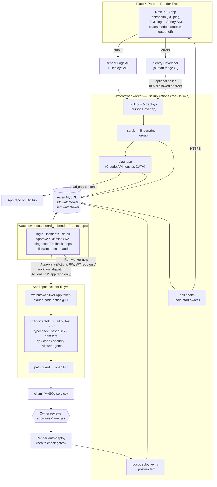
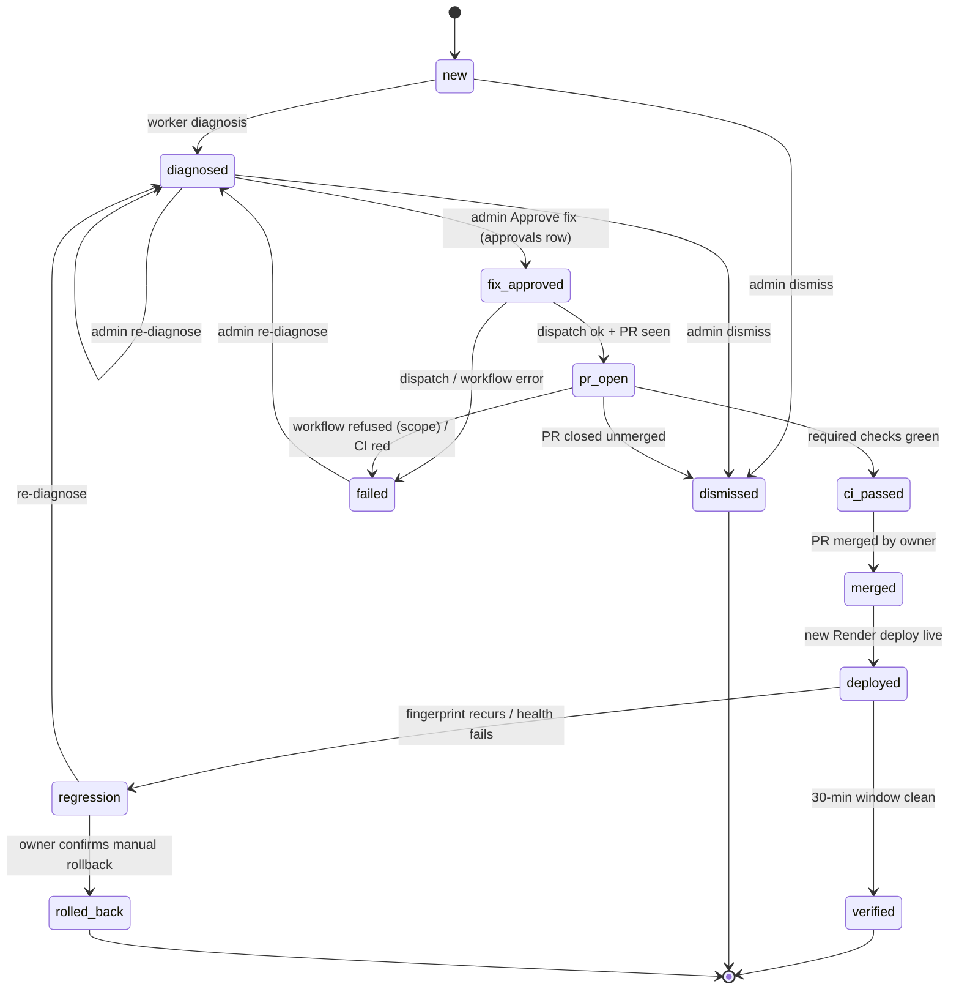

# Watchtower architecture

## 1. System diagram

The whole system runs on free plans (see [ADR 0002](adr/0002-actions-worker-and-sleeping-dashboard.md)). The worker uses no Render hours. The dashboard uses Render hours only while you have it open.

## 2. Components

| Component | Runs on | Credentials it holds | Never holds |
|---|---|---|---|
| Worker (`worker/`) | GitHub Actions, `schedule` + `workflow_dispatch` only | `WT_DATABASE_*`, `RENDER_API_KEY`, `ANTHROPIC_API_KEY`, a read-only GitHub contents token, optional `SENTRY_API_TOKEN` | App DB credentials, any merge/push token |
| Dashboard (`app/`) | Render Free web service | `WT_DATABASE_*`, `ADMIN_*`, `SESSION_SECRET`, `GITHUB_DISPATCH_TOKEN`, `GITHUB_WORKER_TOKEN` | `RENDER_API_KEY`, `ANTHROPIC_API_KEY`, app DB credentials |
| Fix workflow | App repo GitHub Actions | `ANTHROPIC_API_KEY`, `watchtower-fixer` App ID + private key | Production DB credentials (CI uses a throwaway MySQL container) |

Diagnosis runs in the worker, never in the dashboard. A dashboard click such as Re-diagnose writes a request row and then dispatches the worker workflow. Because of this split, the internet-facing dashboard never holds the Anthropic or Render keys.

## 3. Data model (database `watchtower`)

| Table | Purpose | Key columns |
|---|---|---|
| `schema_migrations` | Applied migrations | `version`, `applied_at` |
| `raw_events` | Scrubbed signals (log line, health result, Sentry issue, deploy). Purged after 14 days. | `id`, `source` (`render_log`/`health`/`sentry`/`deploy`/`seed`), `external_id` (unique per source), `occurred_at`, `level`, `message_scrubbed`, `stack_scrubbed`, `route`, `fingerprint`, `incident_id` |
| `incidents` | One per fingerprint (and per health-down episode) | `id`, `fingerprint` (unique while open), `title`, `kind` (`error`/`health`/`db`/`slow_query`), `severity` (`critical`/`high`/`medium`/`low`), `status`, `first_seen`, `last_seen`, `event_count`, `regression_of`, `deploy_id_at_open` |
| `diagnoses` | Claude output, cached per fingerprint + input hash | `id`, `incident_id`, `model`, `input_hash`, `result_json` (schema-validated), `confidence`, `owner_notes`, `created_at` |
| `approvals` | Human decisions; the **only** thing that unlocks a fix | `id`, `incident_id`, `action` (`approve_fix`/`dismiss`/`rediagnose`/`recommend_rollback`), `actor`, `reason`, `diagnosis_id`, `created_at` |
| `actions` | Outbound side effects and their results | `id`, `incident_id`, `approval_id` (NOT NULL for `dispatch_fix`), `type`, `request_ref` (workflow run / PR number), `status`, `error`, `created_at` |
| `audit_log` | Append-only trail of everything | `id`, `at`, `actor` (`worker`/`admin`/`system`), `action`, `incident_id`, `detail_json` (scrubbed), `outcome` |
| `settings` | Kill switch toggle, cursors, last tick | `key`, `value`, `updated_at` |
| `api_usage` | Cost tracking | `id`, `at`, `incident_id`, `model`, `input_tokens`, `cache_read_tokens`, `cache_write_tokens`, `output_tokens`, `cost_usd` |
| `admin_sessions` | Dashboard sessions | `id_hash`, `expires_at` |

## 4. Incident lifecycle (state machine)

Rules enforced in `lib/state-machine.ts`:
- Transitions come from one table. Any other transition throws and is audited.
- `fix_approved` requires inserting an `approvals(action='approve_fix')` row **in the same transaction**.
- `dispatchFix()` reads that approval row with `SELECT … FOR UPDATE` and writes an `actions` row whose `approval_id` is NOT NULL (enforced by an FK and a NOT NULL constraint). With no approval row, nothing is dispatched.
- The kill switch is checked inside `dispatchFix()` and inside `diagnose()`, not only in the UI.
- An incident in `fix_approved` or later can't be approved again. One approval allows one dispatch.

## 5. Detection & grouping

**Fingerprint** = `sha256(kind | error type | location | normalised message)`, computed on the **scrubbed** text. Normalisation replaces numbers, UUIDs, hex IDs, quoted strings, emails and timestamps with placeholders before hashing.
- **Location** = the app route when known (`/api/log/[id]` and `/api/log/42` both become `/api/log/:id`), else the top in-app stack frame (`file:function`, build paths and hashes stripped), else a normalised SQL snippet. Preferring the route lets the same error reported by the Render logs and by Sentry group into **one** incident.
- **Fixed fingerprints:** every "database unreachable" error (any connection code) is one incident, and health polls use fixed app-down / db-down fingerprints.
- **Dedupe:** `raw_events` is unique on `(source, external_id)` (Render log id; Sentry `issue:count`; `health:<time>`; `deploy:status`), so overlapping log windows never double count.
- **Sentry counts:** a Sentry issue whose count grew becomes one event standing for the new occurrences. When the logs and Sentry both report an error, the incident's event count includes both.

**Severity rules** (first match wins):

| Severity | Condition |
|---|---|
| critical | `/api/health` failed on **3 consecutive** polls (each poll has a 120 s timeout and 1 retry), or the health response reports `db: "down"` twice in a row |
| high | A **new** fingerprint at `error` level, or ≥ 10 events of one fingerprint in 15 min, or an error-rate spike of ≥ 5× the 24 h baseline |
| medium | A known fingerprint recurring, or a slow query (> 1 s) ≥ 5 times in 15 min, or a single DB connection error |
| low | Warnings and isolated 4xx bursts |

**Cold-start handling:** a health poll that succeeds after more than 20 s is recorded as `cold_start`, not as a failure. A single failure only raises a `low` "watch" event.

## 6. Diagnosis flow

1. Choose candidates: incidents that are new or escalated, have no cached diagnosis for the current `input_hash`, and are within the rate caps, with the kill switch off.
2. Gather inputs:
   - the scrubbed stack trace
   - up to 50 related log lines
   - the last 10 commits and deploys on `main`
   - the files from the stack frames, fetched read-only at the deployed commit
   - the app's root `CLAUDE.md` plus the folder `CLAUDE.md` for each touched folder
3. Build the prompt: put the system instructions, conventions and code in the cacheable prefix. Put the logs and errors last, inside `<untrusted_log_data>`.
4. Call Claude (Sonnet 5.5) and require JSON matching `schemas/diagnosis.json`:
   - `summary`, `root_cause`
   - `evidence[]` (each item cites an event ID or file:line from the inputs)
   - `confidence`, `blast_radius`
   - `immediate_mitigation`, `fix_approach`
   - `needs_human_only` (a fix would touch forbidden paths)
   - `missing_info[]`
5. Validate the result. Reject it if it fails the schema, cites evidence IDs that weren't supplied, or proposes actions. Rejections are stored as `failed` and nothing happens automatically.
6. Scrub the output again, store it, record its cost and write the audit row.

## 7. Fix flow (phase 4)

1. You click **Approve fix**. The approval row and the state change are committed together. The dashboard calls `POST /repos/{app}/actions/workflows/incident-fix.yml/dispatches` with these inputs:
   - `incident_id`
   - `diagnosis` (scrubbed JSON, base64)
   - `watchtower_url`
2. In the app repo, the workflow:
   - mints a `watchtower-fixer` token and checks out `main`
   - decodes the diagnosis **through `env:` into a file**, never through `${{ }}` in `run:`
   - runs `claude-code-action` with a fixed prompt template that tells it to:
     1. read `CLAUDE.md`
     2. create the branch `fix/incident-<id>`
     3. write a failing regression test
     4. write the fix
     5. run `typecheck`, `test:quick` and `npm test`
     6. run the `qa-tester`, `code-reviewer` and `security-reviewer` agents
     7. write the PR body
3. The **path guard** step diffs the branch against `main` and fails the job if it touches `db/migrations/`, `lib/auth.ts`, `app/api/auth/`, `.github/` or `render.yaml`.
4. The PR is opened by the App, which triggers `ci.yml`. The worker syncs the PR and check status into `actions`.

## 8. Post-deploy verification (phase 5)

The worker sees a new Render deploy whose commit contains the merged PR, and opens a 30-minute window. If health stays green and the fingerprint doesn't recur, the incident becomes `verified` and the worker generates a postmortem. Otherwise it becomes `regression` and the dashboard shows the manual rollback steps. A window that spans the app's sleep periods counts only the minutes when the app was awake, extending to a maximum of 24 h.
